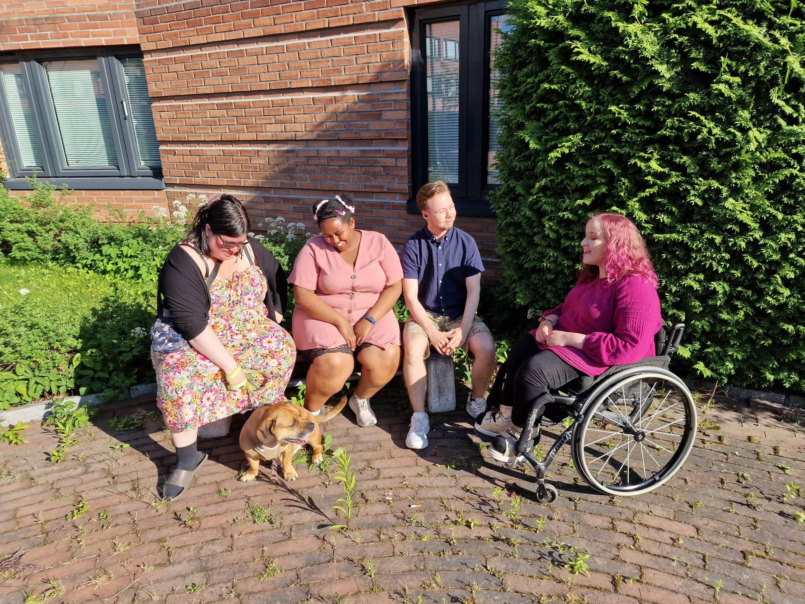
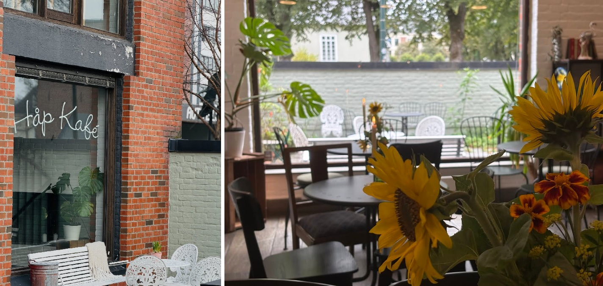

  
import EventsList from "../../src/components/events-list"

# Welcome to Queer Hangout in Drammen!  
  
## About us  
**Queer Hangout** is a meetingplace for gay, lesbian, trans, questioning/experimenting and other queer people in Drammen. We are a volunteer organization that meets once a month.

   

## New in Norway

If you're new to Norway, you're welcome to join us at Queer Hangout! I wish to give you another reccomendation, which is [Queer World.](https://www.skeivverden.no/en/) Queer World is an organisation for LGBTIQ+ people with minority backgrounds, like immigrants. If you want queer friends or just need help, these are great people to ask!

Their website is [https://www.skeivverden.no/en/](https://www.skeivverden.no/en/) 

If you're new to Drammen in general, [Strømsø Knutepunkt](https://www.drammen.kommune.no/om-kommunen/organisasjon-administrasjon/knutepunktene/knutepunkt-stromso/) is the best place to visit first. The people there are happy to talk to you, and know everything about Drammen. They have many free events, where you can meet new friends.

Their website is [https://www.drammen.kommune.no/om-kommunen/organisasjon-administrasjon/knutepunktene/knutepunkt-stromso/](https://www.drammen.kommune.no/om-kommunen/organisasjon-administrasjon/knutepunktene/knutepunkt-stromso/)
They're also on facebook: [https://www.facebook.com/knutepunktstromso](https://www.facebook.com/knutepunktstromso) 

## Events 

All our events are "rusfritt", meaning no alcohol or other substances allowed.
All our events are wheelchair accessible, with HC toilet avalible.
If you have allergies, dietary restrictions or other accessibility needs, feel free to contact us at [post@queerhangout.no](mailto:post@queerhangout.no) and we will do our best to accomodate you!  

### Upcoming events

<EventsList />
  
### Håp Cafe
Last Sunday of every month, 14:00-16:00.  (No hangouts in December)
Open for all queer and questioning people. We rent the room, so it's completely private. Wheelchair accessible with HC-toilet. 
It's in the same building as "Kristelig Dialogsenter", which is 500 meters from Drammen Trainstation.
You may have a free coffee or hot choclate, if you are a member of FRI - Norwegian Organisation for Sexual and Gender Diversity.

Changes or cancellations might happen! To stay updated, follow the calendar above.

**Welcome!**
  

## Rules  
![The safe and inclusive space guidelines, made by Skeiv Verden. One, inclusion, everyone should be included, seen and weelcome. Two, pronouns, respect the pronoun people use. Ask if you don't know. Three, tone of communication, use respectful language, avoid jokes which can easily be misunderstood. Four, touching, ask before making physical contact. People have different needs for personal space. Five, flirting, be mindful of not crossing other people's boundaries, flirting can make some people uncomfortable. Six, privacy, everyone has a different story and can decide what they want to share about themselves. It's okay to say no. Seven, confidentiality, respect anonymity. Do not share personal information of others. Eight, cameras, photos should always be taken with consent. Nine, open mind, misunderstandings happen, take care of each other. Relax, everyone makes mistakes! Accept and or give feedback in a constructive way. And be kind, always!](../images/safespage.jpg "Used with permission by Skeiv Verden")
  
  
1. Be nice to people. Queer Hangout includes exposed minorities like muslims, sex workers, disabled people, trans people, etc. As long as you're willing to learn and be respectful, you will be fine. Bigotry will not be accepted.  
2. Only queer people can go to our events. You're also welcome if you're unsure or exploring identities. It is 100% okay to bring an assistant or a non-queer friend for support.  
3. Ask before you contact someone outside of Queer Hangouts. Not everyone is out of the closet! Don't give out other peoples contact information without permission, even to someone else in the group.  

### Sending a warning  
If you have experienced something uncomfortable at Queer Hangout, then you can mail us at [varsel@queerhangout.no](mailto:varsel@queerhangout.no). This will only be seen by the leader of Queer Hangout, and they will handle the issue as discreetly as possible. If you have a problem with the leadership in Queer Hangout, you can contact our mother organization at <a href="https://www.foreningenfri.no/varsling-2" rel="nofollow" target="_blank">foreningen FRI</a>

## Contact information  
Queer Hangout can be contacted by e-mail: [post@queerhangout.no](mailto:post@queerhangout.no) 

You can also find us on Facebook: [facebook.com/queerhangout](https://facebook.com/queerhangout)  

  
